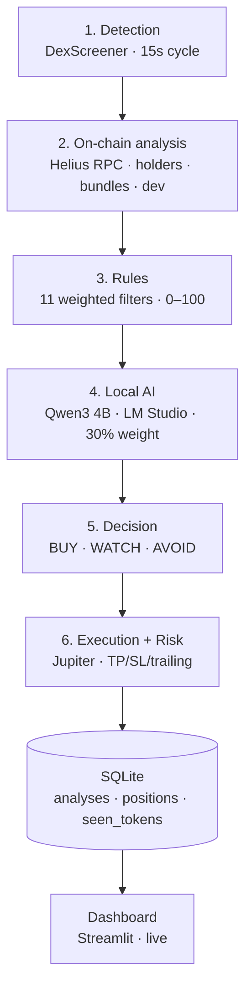
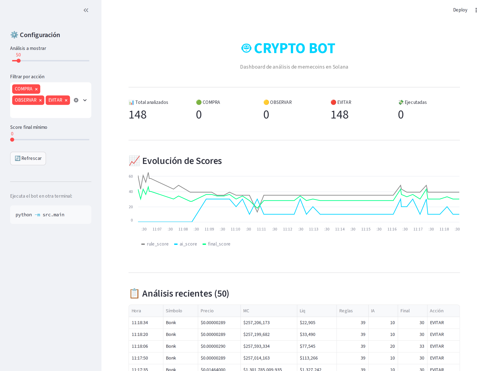
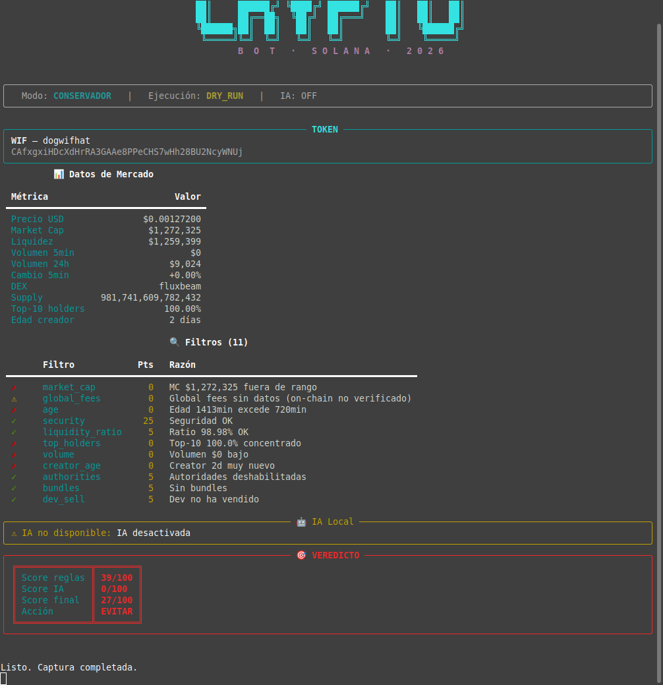

# Crypto Bot — Autonomous memecoin trading on Solana

<p align="center"><b><a href="README.md">🇪🇸 Español</a> · <a href="README.EN.md">🇬🇧 English</a></b></p>

```
  ██████╗██████╗ ██╗   ██╗██████╗ ████████╗ ██████╗
 ██╔════╝██╔══██╗╚██╗ ██╔╝██╔══██╗╚══██╔══╝██╔═══██╗
 ██║     ██████╔╝ ╚████╔╝ ██████╔╝   ██║   ██║   ██║
 ██║     ██╔══██╗  ╚██╔╝  ██╔═══╝    ██║   ██║   ██║
 ╚██████╗██║  ██║   ██║   ██║        ██║   ╚██████╔╝
  ╚═════╝╚═╝  ╚═╝   ╚═╝   ╚═╝        ╚═╝    ╚═════╝
        B  O  T   ·   S O L A N A   ·   2 0 2 6
```

[](https://github.com/caos-ssj/Crypto.Bot/releases)
[]()
[]()
[](https://solana.com)
[]()
[]()
[]()
[](dashboard.py)
[](CONTRIBUTING.md)
[](LICENSE)

Autonomous **Solana memecoin** trading bot: it detects new tokens with
DexScreener, analyzes them with **11 on-chain filters** (Helius), scores them with
**local AI** (Qwen3/LM Studio) and executes real swaps via **Jupiter** with active
risk management (TP/SL/trailing) plus a web dashboard for monitoring.

> ⚠️ **Honest disclaimer:** this software is **for educational and research
> purposes only**. Memecoin trading carries a risk of **total loss of capital**.
> Everything described here runs in `DRY_RUN` (simulation) by default; trading
> with real money is entirely the user's own decision.

---

## ⚙️ Key features

- 🤖 **Full pipeline** · detection (DexScreener) → on-chain analysis (Helius) → local AI → decision → execution (Jupiter)
- 🛡️ **Honest scoring** · 11 weighted filters; unverified data = `0 pts` + `missing`
- 🎯 **Active risk** · TP/SL/trailing, max 3 positions, 0.5 SOL daily loss
- 📊 **Web dashboard** (Streamlit) with live positions and prices
- 🧠 **Local AI** (Qwen3 via LM Studio) with a safe fallback — no cloud dependency

## ⚡ Try it in 3 commands

```bash
git clone git@github.com:caosssj/Crypto.Bot.git && cd Crypto.Bot
python3 -m venv venv && venv/bin/pip install -r requirements.txt
venv/bin/python -m src.main
```

> The interactive menu offers manual/automatic modes (the Streamlit dashboard runs
> with its own command). Without `HELIUS_API_KEY` or a wallet the bot still
> detects, scores and decides: you only add `.env` to enable on-chain analysis.

---

## Table of contents

- [Key features](#key-features)
- [How it works](#how-it-works)
- [Architecture](#architecture)
- [Scoring: the 11 filters](#scoring-the-11-filters)
- [Operation modes](#operation-modes)
- [Risk management](#risk-management)
- [Screenshots](#screenshots)
- [Repository structure](#repository-structure)
- [Quickstart](#quickstart)
- [Configuration](#configuration)
- [Usage](#usage)
- [Testing & quality](#testing--quality)
- [Documentation](#documentation)
- [Roadmap](#roadmap)
- [Contributing](#contributing)
- [License](#license)

---

## How it works

Every token found goes through a 6-stage pipeline. The goal is an **honest
decision**: if an on-chain datapoint cannot be verified, the filter scores
**0 points** (the bot never assumes a token is safe because data is missing).



The final score combines rules and AI, and the decision is binary by thresholds:

```
final_score = 70% × rules_score + 30% × AI_score

  score > 70   →  🟢 BUY      (executes a swap if risk allows)
  50 ≤ score   →  🟡 WATCH    (recorded, not traded)
  score < 50   →  🔴 AVOID
```

On every cycle the bot also:
1. **Monitors open positions** (TP/SL/trailing) before looking for new tokens.
2. Skips already-processed tokens thanks to `seen_tokens` persistence in SQLite
   (no reprocessing or wasted RPC between restarts).
3. Isolates every external API failure: if Helius, LM Studio or DexScreener
   fails, the affected filter scores `0` and **the bot keeps running**.

---

## Architecture

```
Detection (DexScreener) → Analysis (11 filters) → Local AI (Qwen3)
→ Decision → Execution (Jupiter, real wallet) → Risk (TP/SL/trailing)
```

| Module | File | Role |
|---|---|---|
| Orchestrator | `src/main.py` | Rich menu, manual/auto modes, `process_token`, position monitoring |
| Detection | `src/fetcher.py` | DexScreener data (`fetch_by_address`, `fetch_by_symbol`, `fetch_recent_memecoins`). Single normalization source |
| On-chain | `src/chain_data.py` | Helius RPC: mint info, top-10 holders, dev wallet, bundles, dev-sell. Unverified data → `None` |
| Rules | `src/analyzer.py` | 11 weighted filters, 0–100 score and unified decision (`decide`) |
| Local AI | `src/ai.py` | `get_ai_score` with Qwen3 via LM Studio, 30 % weight, robust fallback to 0 |
| Execution | `src/executor.py` | Quotes + real swaps via Jupiter v6 (signed with solders) or `dry_run` |
| Risk | `src/risk.py` | `Position`, TP/SL/trailing, position cap and daily loss |
| Persistence | `src/storage.py` | SQLite: `analyses`, `positions`, `seen_tokens` |
| Configuration | `src/config.py` | `conservative` / `balanced` / `aggressive` modes |

Full detail in [docs/arquitectura.md](docs/arquitectura.md).

---

## Scoring: the 11 filters

Each filter contributes weighted points (max 115, normalized to 100). The visual
weight reflects its importance in the decision:

```
Security         ██████████████  25 pts   no bundles · dev hasn't sold
Market cap       ██████████      20 pts   range per mode
Global fees      ██████████      20 pts   ~ 0.15 SOL (no reliable source yet)
Token age        ████████        15 pts   < 24 h
Liquidity / MC   ██               5 pts   > 3 %
Top-10 holders   ██               5 pts   < 50 %
5-min volume     ██               5 pts   > $2 K
Creator age      ██               5 pts   > 3 days
Authorities      ██               5 pts   mint/freeze disabled
Bundles          ██               5 pts   no grouped launch
Dev sell         ██               5 pts   dev hasn't dumped their bag
```

**Unverified-data policy** (a critical project rule): if an on-chain field could
not be confirmed (RPC failure, missing API data), it is stored as `None`, the
filter scores `0` and it is flagged `status: "missing"`. The score is never
inflated by assuming a token is safe because data is missing.

Full detail in [docs/filtros.md](docs/filtros.md).

---

## Operation modes

Thresholds change per mode (defined in `src/config.py`):

| Parameter | Conservative | Balanced | Aggressive |
|---|---|---|---|
| Min market cap | $50 K | $20 K | $5 K |
| Max market cap | $500 K | $800 K | $1 M |
| Max age | 12 h (720 min) | 24 h (1440 min) | 48 h (2880 min) |
| Min global fees | 0.3 SOL | 0.15 SOL | 0.05 SOL |
| Base buy | 0.05 SOL | 0.03 SOL | 0.01 SOL |
| Max exposure | 0.15 SOL | 0.09 SOL | 0.03 SOL |

---

## Risk management

| Rule | Value | Behavior |
|---|---|---|
| Take Profit (TP) | **+20 %** | Sells the full position when the price is reached |
| Stop Loss (SL) | **−10 %** | Sells the full position when the price is reached |
| Trailing stop | activates at **+5 %**, distance **10 %** | Raises the SL as price makes new highs |
| Max positions | **3** | New signals are ignored while 3 are open |
| Daily loss | **0.5 SOL** | Blocks new buys (monitoring keeps running) |
| Price impact | **max 5 %** | Aborts the swap if impact exceeds the limit |
| Slippage | **1 % (100 bps)** | Jupiter quote parameter |
| Default mode | `DRY_RUN` | Sends no transactions; simulates the full flow |

The monitoring cycle runs **at the start of every cycle** (before searching new
tokens): it updates the trailing stop and, when TP/SL is hit, sells (real or
simulated) and closes the position in SQLite. Detail in [docs/riesgo.md](docs/riesgo.md).

---

## Screenshots

| Streamlit dashboard (live risk/positions) | CLI report (manual mode, dry-run) |
|---|---|
|  |  |

---

## Repository structure

```
crypto-bot/
├── src/
│   ├── main.py          # orchestrator + rich UI + position monitoring
│   ├── fetcher.py       # DexScreener (single normalization source)
│   ├── chain_data.py    # on-chain via Helius (security, holders, dev)
│   ├── analyzer.py      # 11 weighted filters + score + decision
│   ├── ai.py            # local AI Qwen3 (LM Studio), 30 % weight
│   ├── executor.py      # real swaps via Jupiter (solders) / dry_run
│   ├── risk.py          # TP, SL, trailing, risk limits
│   ├── storage.py       # SQLite: analyses, positions, seen_tokens
│   ├── config.py        # conservative / balanced / aggressive modes
│   └── utils.py         # retry with backoff, formatters
├── dashboard.py         # web dashboard (Streamlit)
├── tests/               # 130 tests (pytest)
├── docs/                # architecture · filters · risk · qa · bug-reports
├── CONTRIBUTING.md      # how to contribute
├── SECURITY.md          # vulnerability disclosure policy
├── CODE_OF_CONDUCT.md
├── ruff.toml            # lint (blocking in CI)
├── requirements.txt
└── .github/             # CI · issue/PR templates · dependabot · social preview
```

---

## Quickstart

```bash
git clone git@github.com:caosssj/Crypto.Bot.git
cd Crypto.Bot
python3 -m venv venv
source venv/bin/activate
pip install -r requirements.txt
cp .env.example .env     # set SOLANA_RPC_URL and HELIUS_API_KEY
```

> The project uses `venv/bin/` for every command (no Poetry/uv).

---

## Configuration

All configuration comes from environment variables (`.env`).

| Variable | Required | Description |
|---|---|---|
| `SOLANA_RPC_URL` | ✅ | Solana RPC endpoint |
| `HELIUS_API_KEY` | ~ | Helius API key (on-chain analysis; if missing, filters stay `missing`) |
| `WALLET_PRIVATE_KEY` | ⚠️ | **base58** private key (64 bytes). **Only** needed with `DRY_RUN=false` |
| `JUPITER_API_URL` | – | Jupiter API base (`https://quote-api.jup.ag/v6`) |
| `LM_STUDIO_URL` | – | Local LM Studio server URL (`http://localhost:1234`) |
| `LM_STUDIO_MODEL` | – | Local model (`qwen/qwen3-4b-2507`) |
| `MODE` | – | `conservative` · `balanced` · `aggressive` |
| `DRY_RUN` | – | `true` simulation (default) · `false` real trading |
| `USE_AI` | – | `true` uses local AI in scoring |
| `LOG_LEVEL` | – | Bot log level |

---

## Usage

```bash
venv/bin/python -m src.main          # CLI (interactive menu: manual / automatic)
venv/bin/streamlit run dashboard.py  # web dashboard
```

- **Manual mode:** analyzes a specific token by address or symbol (e.g. `WIF`).
- **Automatic mode:** 15 s loop that detects, analyzes and monitors.
- **Dashboard:** metrics, score evolution, recent analyses and the
  **Risk/Positions** section with live prices (TP/SL/trailing, P&L and daily loss).

---

## Testing & quality

```bash
venv/bin/python -m pytest tests/ -q --cov=src --cov-fail-under=60
venv/bin/ruff check src/ tests/
venv/bin/black --check src/ tests/
```

- **130 tests** cover rules, filters, on-chain, real swaps (mocked), risk and
  storage. Current coverage: **67 %**.
- **ruff and black are blocking in CI** since v2.1 (before they ran with
  `|| true` and the pipeline always passed). Only `BLE001`/`S110` are ignored at
  API boundaries — see [ruff.toml](ruff.toml) and CLAUDE.md §6.
- The banner and docs are in Spanish; the code follows the conventions in
  [CLAUDE.md](CLAUDE.md).

---

## Documentation

- [docs/arquitectura.md](docs/arquitectura.md) — structure, flow and resilience
- [docs/filtros.md](docs/filtros.md) — the 11 filters, thresholds and test cases
- [docs/riesgo.md](docs/riesgo.md) — risk management and the monitoring cycle
- [docs/qa-plan.md](docs/qa-plan.md) — QA plan
- [docs/bug-reports/](docs/bug-reports/) — bugs and lessons learned
- [CHANGELOG.md](CHANGELOG.md) — version history
- [CLAUDE.md](CLAUDE.md) — memory context for AI agents
- [CONTRIBUTING.md](CONTRIBUTING.md) — how to contribute
- [SECURITY.md](SECURITY.md) — security policy
- [docs/PUBLIC-LAUNCH-CHECKLIST.md](docs/PUBLIC-LAUNCH-CHECKLIST.md) — public-launch checklist

---

## Roadmap

**Done (v2.0 → v2.2):**

- [x] Web dashboard (Streamlit) with live risk/positions section
- [x] Real swap execution (Jupiter v6 + solders) and automatic sells
- [x] Honest scoring: unverified data = `0 pts` + `status: missing`
- [x] SQLite persistence (`analyses`, `positions`, `seen_tokens`)
- [x] Hardened CI (ruff/black/pytest with blocking coverage)

**Planned:**

- [ ] Confirmation of sent transactions (`getSignatureStatuses` + retries)
- [ ] Partial position sells (%)
- [ ] SOL wallet balance monitoring ("cash")
- [ ] Backtesting with historical data
- [ ] Pump.fun detection via WebSocket
- [ ] Profitable-wallet monitoring
- [ ] Dynamic filters
- [ ] Dynamic TP/SL (ATR)
- [ ] Multi-wallet support
- [ ] AI model fine-tuning
- [ ] Telegram integration

---

## Contributing

Ideas, bugs or feature requests? Check [CONTRIBUTING.md](CONTRIBUTING.md), open
an [issue](https://github.com/caosssj/Crypto.Bot/issues) using the templates and
send a PR. **PRs welcome** 👋

---

## License

**GNU GPL v3** — free software with **copyleft**: anyone may use, modify and
distribute it, but derivative works must remain **open-source** under the same
license (it cannot be reused in closed source or sold without opening the code).
See [LICENSE](LICENSE).

**Disclaimer:** this software is distributed **for educational and research
purposes**. It does not provide financial advice. Cryptocurrency trading carries
a risk of total loss of capital; the author is not responsible for misuse.