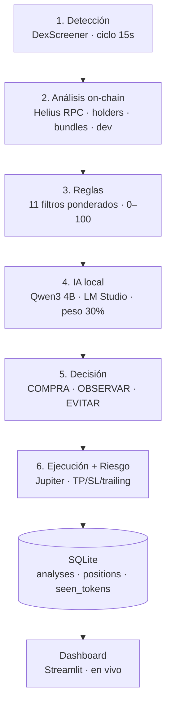
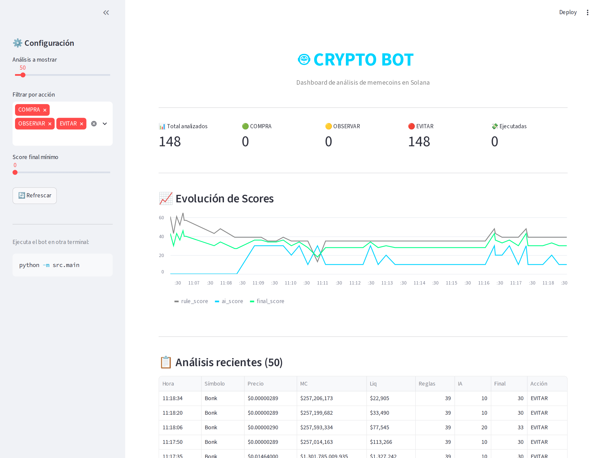
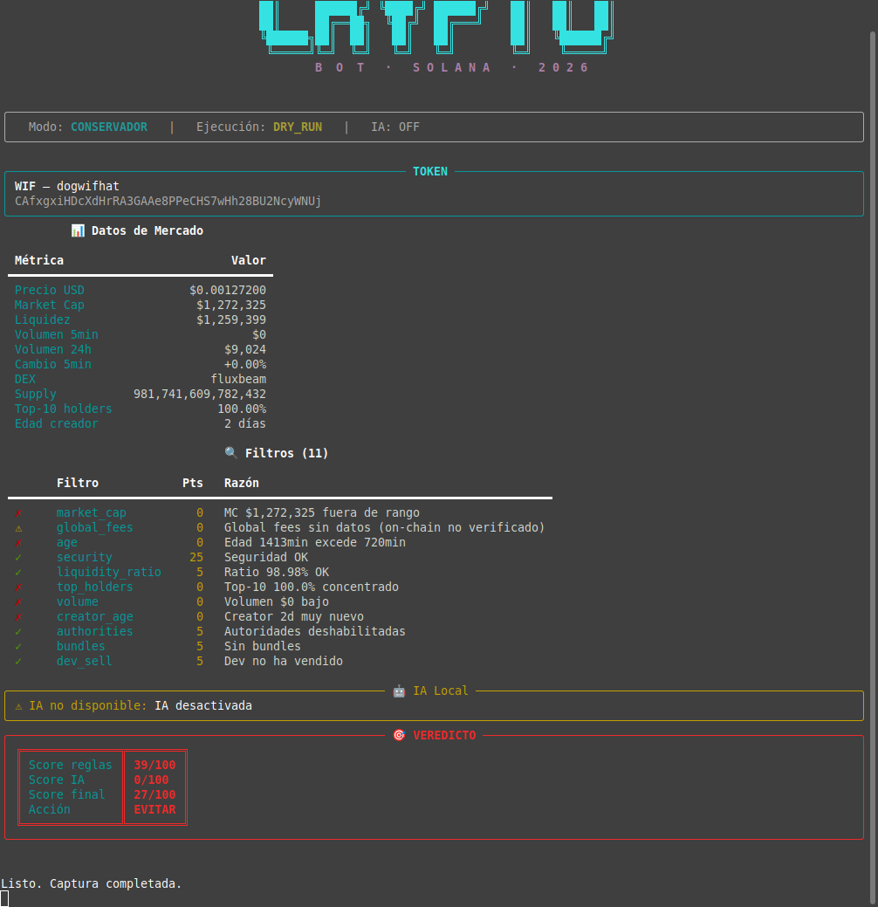

# Crypto Bot — Trading autónomo de memecoins en Solana

<p align="center"><b><a href="README.md">🇪🇸 Español</a> · <a href="README.EN.md">🇬🇧 English</a></b></p>

```
  ██████╗██████╗ ██╗   ██╗██████╗ ████████╗ ██████╗
 ██╔════╝██╔══██╗╚██╗ ██╔╝██╔══██╗╚══██╔══╝██╔═══██╗
 ██║     ██████╔╝ ╚████╔╝ ██████╔╝   ██║   ██║   ██║
 ██║     ██╔══██╗  ╚██╔╝  ██╔═══╝    ██║   ██║   ██║
 ╚██████╗██║  ██║   ██║   ██║        ██║   ╚██████╔╝
  ╚═════╝╚═╝  ╚═╝   ╚═╝   ╚═╝        ╚═╝    ╚═════╝
        B  O  T   ·   S O L A N A   ·   2 0 2 6
```

[](https://github.com/caos-ssj/Crypto.Bot/releases)
[]()
[]()
[](https://solana.com)
[]()
[]()
[]()
[](dashboard.py)
[](CONTRIBUTING.md)
[](LICENSE)

Bot autónomo de trading de memecoins en **Solana**: detecta tokens nuevos con
DexScreener, los analiza con **11 filtros on-chain** (Helius), los evalúa con
**IA local** (Qwen3/LM Studio) y ejecuta swaps reales vía **Jupiter** con
gestión de riesgo activa (TP/SL/trailing) y un dashboard web para monitorearlo.

> ⚠️ **Aviso honesto:** este software es **con fines educativos y de
> investigación**. El trading de memecoins conlleva riesgo de pérdida total del
> capital. Todo lo que se describe aquí funciona en `DRY_RUN` (simulación) por
> defecto; operar con dinero real es una decisión exclusiva del usuario.

---

## ⚙️ Características clave

- 🤖 **Pipeline completo** · detección (DexScreener) → análisis on-chain (Helius) → IA local → decisión → ejecución (Jupiter)
- 🛡️ **Scoring honesto** · 11 filtros ponderados; dato no verificado = `0 pts` + `missing`
- 🎯 **Riesgo activo** · TP/SL/trailing, máx. 3 posiciones, pérdida diaria 0.5 SOL
- 📊 **Dashboard web** (Streamlit) con posiciones y precios en vivo
- 🧠 **IA local** (Qwen3 vía LM Studio) con fallback seguro, sin dependencia de nube

## ⚡ Pruébalo en 3 comandos

```bash
git clone git@github.com:caosssj/Crypto.Bot.git && cd Crypto.Bot
python3 -m venv venv && venv/bin/pip install -r requirements.txt
venv/bin/python -m src.main
```

> El menú interactivo ofrece los modos manual/automático y el dashboard (Streamlit)
> se abre con un comando propio. Sin `HELIUS_API_KEY` ni wallet el bot igual
> detecta, puntúa y decide: solo agregas `.env` para activar el análisis on-chain.

---

## Tabla de contenido

- [Características clave](#características-clave)
- [Cómo funciona](#cómo-funciona)
- [Arquitectura](#arquitectura)
- [Scoring: los 11 filtros](#scoring-los-11-filtros)
- [Modos de operación](#modos-de-operación)
- [Gestión de riesgo](#gestión-de-riesgo)
- [Capturas](#capturas)
- [Estructura del repositorio](#estructura-del-repositorio)
- [Quickstart](#quickstart)
- [Configuración](#configuración)
- [Uso](#uso)
- [Testing y calidad](#testing-y-calidad)
- [Documentación](#documentación)
- [Roadmap](#roadmap)
- [Contribuir](#contribuir)
- [Licencia](#licencia)

---

## Cómo funciona

Cada token encontrado pasa por un pipeline de 6 etapas. El objetivo es tomar
una **decisión honesta**: si un dato on-chain no puede verificarse, el filtro
da **0 puntos** (nunca se asume que un token es seguro por falta de datos).



El score final combina reglas e IA, y la decisión es binaria según umbrales:

```
final_score = 70% × score_reglas + 30% × score_IA

  score > 70   →  🟢 COMPRA   (ejecuta swap si el riesgo lo permite)
  50 ≤ score   →  🟡 OBSERVAR (se registra, no se opera)
  score < 50   →  🔴 EVITAR
```

En cada ciclo el bot además:
1. **Monitorea posiciones abiertas** (TP/SL/trailing) antes de buscar tokens nuevos.
2. Salta tokens ya procesados gracias a la persistencia de `seen_tokens` en
   SQLite (evita reprocesos y gasto innecesario de RPC entre reinicios).
3. Aísla los fallos de cada API externa: si Helius, LM Studio o DexScreener
   fallan, el filtro afectado da `0 pts` y **el bot sigue corriendo**.

---

## Arquitectura

```
Detección (DexScreener) → Análisis (11 filtros) → IA local (Qwen3)
→ Decisión → Ejecución (Jupiter, wallet real) → Riesgo (TP/SL/trailing)
```

| Módulo | Archivo | Rol |
|---|---|---|
| Orquestador | `src/main.py` | Menú rich, modos manual/automático, `process_token`, monitoreo de posiciones |
| Detección | `src/fetcher.py` | Datos DexScreener (`fetch_by_address`, `fetch_by_symbol`, `fetch_recent_memecoins`). Única fuente de normalización |
| On-chain | `src/chain_data.py` | Helius RPC: mint info, top-10 holders, wallet del dev, bundles, dev-sell. Dato no verificado → `None` |
| Reglas | `src/analyzer.py` | 11 filtros ponderados, score 0–100 y decisión unificada (`decide`) |
| IA local | `src/ai.py` | `get_ai_score` con Qwen3 via LM Studio, peso 30 %, fallback robusto a 0 |
| Ejecución | `src/executor.py` | Quotes + swaps reales vía Jupiter v6 (firma con solders) o `dry_run` |
| Riesgo | `src/risk.py` | `Position`, TP/SL/trailing, límite de posiciones y pérdida diaria |
| Persistencia | `src/storage.py` | SQLite: `analyses`, `positions`, `seen_tokens` |
| Configuración | `src/config.py` | Modos `conservador` / `equilibrado` / `agresivo` |

Detalle completo en [docs/arquitectura.md](docs/arquitectura.md).

---

## Scoring: los 11 filtros

Cada filtro aporta puntos ponderados (máximo 115, normalizados a 100). El peso
visual refleja su importancia en la decisión:

```
Seguridad        ██████████████  25 pts   sin bundles · dev sin vender
Market cap       ██████████      20 pts   rango según modo
Global fees      ██████████      20 pts   ~ 0.15 SOL (sin fuente fiable hoy)
Edad del token   ████████        15 pts   < 24 h
Liquidez / MC    ██               5 pts   > 3 %
Top-10 holders   ██               5 pts   < 50 %
Volumen 5 min    ██               5 pts   > $2 K
Edad del creador ██               5 pts   > 3 días
Autoridades      ██               5 pts   mint/freeze deshabilitadas
Bundles          ██               5 pts   sin lanzamiento agrupado
Dev sell         ██               5 pts   el dev no ha soltado su bolsa
```

**Política de datos no verificados** (regla crítica del proyecto): si un campo
on-chain no pudo confirmarse (fallo de RPC, API sin datos), se guarda como
`None`, el filtro da `0 pts` y se marca `status: "missing"`. El score jamás se
infla asumiendo que un token es seguro por falta de datos.

Detalle completo en [docs/filtros.md](docs/filtros.md).

---

## Modos de operación

Los umbrales cambian según el modo (definidos en `src/config.py`):

| Parámetro | Conservador | Equilibrado | Agresivo |
|---|---|---|---|
| Market cap mínimo | $50 K | $20 K | $5 K |
| Market cap máximo | $500 K | $800 K | $1 M |
| Edad máxima | 12 h (720 min) | 24 h (1440 min) | 48 h (2880 min) |
| Global fees mín. | 0.3 SOL | 0.15 SOL | 0.05 SOL |
| Compra base | 0.05 SOL | 0.03 SOL | 0.01 SOL |
| Exposición máx. | 0.15 SOL | 0.09 SOL | 0.03 SOL |

---

## Gestión de riesgo

| Regla | Valor | Comportamiento |
|---|---|---|
| Take Profit (TP) | **+20 %** | Venta de la posición completa al alcanzar el precio |
| Stop Loss (SL) | **−10 %** | Venta de la posición completa al alcanzar el precio |
| Trailing stop | activa al **+5 %**, distancia **10 %** | Sube el SL conforme el precio hace máximos |
| Máx. posiciones | **3** | Se ignoran nuevas señales si hay 3 abiertas |
| Pérdida diaria | **0.5 SOL** | Bloquea nuevas compras (el bot sigue monitoreando) |
| Price impact | **máx 5 %** | Aborta el swap si el impacto excede el límite |
| Slippage | **1 % (100 bps)** | Parámetro del quote de Jupiter |
| Modo por defecto | `DRY_RUN` | No envía transacciones; simula el flujo completo |

El ciclo de monitoreo corre **al inicio de cada ciclo** (antes de buscar tokens
nuevos): actualiza el trailing y, al tocar TP/SL, vende (real o simulado) y
cierra la posición en SQLite. Detalle en [docs/riesgo.md](docs/riesgo.md).

---

## Capturas

| Dashboard Streamlit (riesgo/posiciones en vivo) | Reporte CLI (modo manual, dry-run) |
|---|---|
|  |  |

---

## Estructura del repositorio

```
crypto-bot/
├── src/
│   ├── main.py          # orquestador + UI rich + monitoreo de posiciones
│   ├── fetcher.py       # DexScreener (única fuente de normalización)
│   ├── chain_data.py    # on-chain vía Helius (seguridad, holders, dev)
│   ├── analyzer.py      # 11 filtros ponderados + score + decisión
│   ├── ai.py            # IA local Qwen3 (LM Studio), peso 30 %
│   ├── executor.py      # swaps reales vía Jupiter (solders) / dry_run
│   ├── risk.py          # TP, SL, trailing, límites de riesgo
│   ├── storage.py       # SQLite: analyses, positions, seen_tokens
│   ├── config.py        # modos conservador / equilibrado / agresivo
│   └── utils.py         # retry con backoff, formateadores
├── dashboard.py         # dashboard web (Streamlit)
├── tests/               # 177 tests (pytest)
├── docs/                # arquitectura · filtros · riesgo · qa · bug-reports
├── CONTRIBUTING.md      # cómo contribuir
├── SECURITY.md          # política de divulgación de vulnerabilidades
├── CODE_OF_CONDUCT.md
├── ruff.toml            # lint (queda bloqueante en CI)
├── requirements.txt
└── .github/             # CI · issue/PR templates · dependabot · social preview
```

---

## Quickstart

```bash
git clone git@github.com:caosssj/Crypto.Bot.git
cd Crypto.Bot
python3 -m venv venv
source venv/bin/activate
pip install -r requirements.txt
cp .env.example .env     # configura SOLANA_RPC_URL y HELIUS_API_KEY
```

> El proyecto usa `venv/bin/` para todos los comandos (no Poetry/uv).

---

## Configuración

Toda la configuración viene de variables de entorno (`.env`).

| Variable | Obligatoria | Descripción |
|---|---|---|
| `SOLANA_RPC_URL` | ✅ | Endpoint RPC de Solana |
| `HELIUS_API_KEY` | ~ | API key de Helius (análisis on-chain; si falta, los filtros quedan `missing`) |
| `WALLET_PRIVATE_KEY` | ⚠️ | Clave privada **base58** (64 bytes). **Solo** necesaria con `DRY_RUN=false` |
| `JUPITER_API_URL` | – | Base de Jupiter API (`https://quote-api.jup.ag/v6`) |
| `LM_STUDIO_URL` | – | URL del servidor local de LM Studio (`http://localhost:1234`) |
| `LM_STUDIO_MODEL` | – | Modelo local (`qwen/qwen3-4b-2507`) |
| `MODE` | – | `conservador` · `equilibrado` · `agresivo` |
| `DRY_RUN` | – | `true` simulación (por defecto) · `false` operaciones reales |
| `USE_AI` | – | `true` usa la IA local en el scoring |
| `LOG_LEVEL` | – | Nivel de log del bot |

---

## Uso

```bash
venv/bin/python -m src.main          # CLI (menú interactivo: manual / automático)
venv/bin/streamlit run dashboard.py  # dashboard web
```

- **Modo manual:** analiza un token específico por address o símbolo (ej. `WIF`).
- **Modo automático:** bucle cada 15 s que detecta, analiza y monitorea.
- **Dashboard:** métricas, evolución de scores, análisis recientes y la sección
  **Riesgo/Posiciones** con precios en vivo (TP/SL/trailing, P&L y pérdida
  diaria).

---

## Testing y calidad

```bash
venv/bin/python -m pytest tests/ -q --cov=src --cov-fail-under=60
venv/bin/ruff check src/ tests/
venv/bin/black --check src/ tests/
```

- **177 tests** cubren reglas, filtros, on-chain, IA local, swaps reales
  (mockeados), riesgo y storage. Cobertura actual: **83 %** (fetcher 94 %,
  main 70 %, risk 100 %, analyzer 96 %).
- **ruff** y **black son bloqueantes en CI** desde v2.1 (antes corrían con
  `|| true` y el pipeline siempre pasaba). Solo se ignoran `BLE001`/`S110` en
  las fronteras de API — ver [ruff.toml](ruff.toml) y CLAUDE.md §6.
- Banner/documentación están en español; el código sigue las convenciones de
  [CLAUDE.md](CLAUDE.md).

---

## Documentación

- [docs/arquitectura.md](docs/arquitectura.md) — estructura, flujo y resiliencia
- [docs/filtros.md](docs/filtros.md) — los 11 filtros, umbrales y casos de prueba
- [docs/riesgo.md](docs/riesgo.md) — gestión de riesgo y ciclo de monitoreo
- [docs/qa-plan.md](docs/qa-plan.md) — plan de QA
- [docs/bug-reports/](docs/bug-reports/) — bugs y lecciones aprendidas
- [CHANGELOG.md](CHANGELOG.md) — historial de versiones
- [CLAUDE.md](CLAUDE.md) — contexto de memoria para agentes de IA
- [CONTRIBUTING.md](CONTRIBUTING.md) — cómo contribuir
- [SECURITY.md](SECURITY.md) — política de seguridad
- [docs/PUBLIC-LAUNCH-CHECKLIST.md](docs/PUBLIC-LAUNCH-CHECKLIST.md) — checklist para el lanzamiento público

---

## Roadmap

**Hecho (v2.0 → v2.2):**

- [x] Dashboard web (Streamlit) con sección de riesgo/posiciones en vivo
- [x] Ejecución real de swaps (Jupiter v6 + solders) y ventas automáticas
- [x] Scoring honesto: dato no verificado = `0 pts` + `status: missing`
- [x] Persistencia SQLite (`analyses`, `positions`, `seen_tokens`)
- [x] CI endurecido (ruff/black/pytest con cobertura bloqueante)

**Pendiente:**

- [ ] Confirmación de transacciones enviadas (`getSignatureStatuses` + reintentos)
- [ ] Venta parcial de posiciones (%)
- [ ] Monitoreo de saldo SOL de la wallet ("caja")
- [ ] Backtesting con datos históricos
- [ ] Detección Pump.fun vía WebSocket
- [ ] Monitoreo de wallets rentables
- [ ] Filtros dinámicos
- [ ] TP/SL dinámicos (ATR)
- [ ] Soporte multi-wallet
- [ ] Fine-tuning del modelo de IA
- [ ] Integración con Telegram

---

## Contribuir

¿Ideas, bugs o features? Revisa [CONTRIBUTING.md](CONTRIBUTING.md), abre un
[issue](https://github.com/caosssj/Crypto.Bot/issues) usando los templates y
envía un PR. **PRs welcome** 👋

---

## Licencia

**GNU GPL v3** — código libre con **copyleft**: cualquiera puede usar, modificar y
distribuir el software, pero las obras derivadas deben seguir siendo
**open-source** bajo la misma licencia (no se puede reutilizar en closed-source ni
venderlo sin abrir el código). Ver [LICENSE](LICENSE).

**Disclaimer:** este software se distribuye **con fines educativos y de
investigación**. No ofrece asesoría financiera. El trading de criptomonedas
conlleva riesgo de pérdida total del capital; el autor no se hace responsable
del uso indebido.