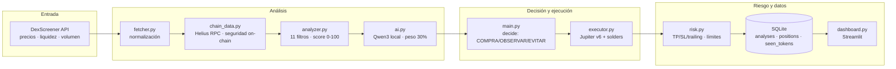
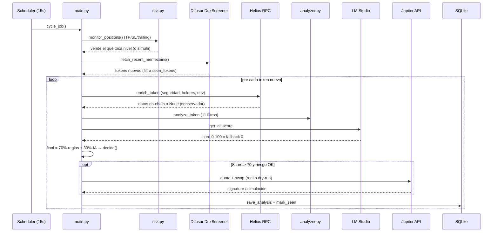

# Arquitectura del Bot

## Visión general

Bot autónomo de trading de memecoins en **Solana**. Detecta tokens nuevos con
DexScreener, los analiza con **11 filtros ponderados**, evalúa contexto con
**IA local** (Qwen3 vía LM Studio) y ejecuta swaps vía **Jupiter** con gestión
de riesgo activa (TP/SL/trailing). Toda la actividad se persiste en **SQLite**
y se visualiza en un **dashboard Streamlit**.

Pipeline:

```
Detección (DexScreener) → Análisis (11 filtros) → IA local (Qwen3)
→ Decisión → Ejecución (Jupiter) → Riesgo (TP/SL/trailing) → Dashboard
```

## Diagrama de componentes



## Diagrama de secuencia (ciclo de 15 s)



## Módulos

| Módulo | Archivo | Rol | Estado |
|---|---|---|---|
| Orquestador | `src/main.py` | Menú rich, modos manual/automático, `process_token`, monitoreo de posiciones | ✅ activo |
| Detección | `src/fetcher.py` | DexScreener (`fetch_by_address`, `fetch_by_symbol`, `fetch_recent_memecoins`). **Única** fuente de normalización (`_normalize_pair`); el antiguo `detector.py` fue eliminado | ✅ activo |
| On-chain | `src/chain_data.py` | Helius RPC: mint info, top-10 holders, wallet del dev, seguridad (bundles/dev-sell). Caché `lru_cache`. Dato no verificado → `None` (conservador) | ✅ activo |
| Reglas | `src/analyzer.py` | 11 filtros ponderados, score normalizado 0-100, `decide()`, campo `status` por filtro | ✅ activo |
| IA local | `src/ai.py` | `get_ai_score` con Qwen3 (peso 30 %), fallback robusto si el servidor no responde | ✅ activo |
| Ejecución | `src/executor.py` | Quotes + swaps vía Jupiter (`/v6/quote`, `/v6/swap`); firma con solders y `sendTransaction` (real). Compra SOL→token y venta token→SOL | ✅ real |
| Riesgo | `src/risk.py` | `Position`, TP/SL/trailing, límite de posiciones y de pérdida diaria | ✅ conectado a `main` |
| Persistencia | `src/storage.py` | SQLite: `analyses`, `positions`, `seen_tokens` | ✅ activo |
| Configuración | `src/config.py` | Modos `conservador` / `equilibrado` / `agresivo` | ✅ activo |
| Utilidades | `src/utils.py` | `retry_with_backoff` (3 intentos, backoff 0.5→1.0→2.0 s), `format_sol`, `safe_float` | ✅ activo |

## Configuración

La configuración **solo** viene de variables de entorno (`.env`). El archivo
`config/config.yaml` existe pero **no se usa**.

Variables (ver `.env.example`): `SOLANA_RPC_URL`, `HELIUS_API_KEY`,
`WALLET_PRIVATE_KEY` (base58, usada con `DRY_RUN=false`), `JUPITER_API_URL`,
`LM_STUDIO_URL`, `LM_STUDIO_MODEL`, `MODE`, `DRY_RUN`, `USE_AI`, `LOG_LEVEL`.

### Modos de operación (`src/config.py`)

| Parámetro | Conservador | Equilibrado | Agresivo |
|---|---|---|---|
| MC mínimo | $50 K | $20 K | $5 K |
| MC máximo | $500 K | $800 K | $1 M |
| Edad máx | 720 min | 1440 min | 2880 min |
| Global fees | 0.3 SOL | 0.15 SOL | 0.05 SOL |
| Compra base | 0.05 SOL | 0.03 SOL | 0.01 SOL |

## Flujo de datos (detalle)

1. `fetcher` consulta DexScreener cada 15 s.
2. Se filtran los tokens ya procesados usando `seen_tokens` (persistido en
   SQLite a través de reinicios).
3. `chain_data` extrae datos on-chain vía Helius: mint/freeze authority,
   top-10 holders, wallet del dev (fee payer de la tx de creación), bundles y
   ventas del dev. Todo con caché y fallo conservador (`None`).
4. `analyzer` aplica los 11 filtros y calcula el score. **Datos no verificados
   → 0 pts + `status: missing`** (jamás se infla el score).
5. La IA local evalúa el contexto y ajusta el score (peso 30 %).
6. Decisión unificada (`analyzer.decide`): `>70 COMPRA` · `>=50 OBSERVAR` ·
   resto `EVITAR`.
7. Si `COMPRA` y el riesgo lo permite → `executor` construye y envía el swap
   vía Jupiter (real o `dry_run`).
8. `risk` registra la posición y `monitor_positions` monitorea TP/SL/trailing
   al inicio de cada ciclo.
9. Cada token procesado se marca en `seen_tokens`.

## Persistencia

SQLite sin ORM (`logs/bot.db`, gitignored):

- **`analyses`**: reportes completos por token (score, IA, acción, detalles JSON).
- **`positions`**: posiciones abiertas/cerradas con TP/SL/trailing y P&L.
- **`seen_tokens`**: tokens ya procesados (evita reprocesos entre reinicios).

Nota histórica: las posiciones ya **no** se guardan en `logs/positions.json`;
todo vive en SQLite desde v2.0.

## Resiliencia ante fallos externos

El bot consulta múltiples APIs externas (DexScreener, Helius, LM Studio,
Jupiter). Cada una puede fallar de forma independiente.

### Estrategia de manejo de fallos

| Fuente | Fallo típico | Manejo |
|---|---|---|
| DexScreener | Timeout / rate limit | Retry con backoff → lista vacía |
| Helius RPC | 500 server error / método no soportado | `getMultipleTransactions` con fallback a `getTransaction`; filtro devuelve valor conservador (falla el filtro, no el bot) |
| LM Studio | Offline / timeout / thinking mode vacío | Fallback a score 0; decisión basada solo en reglas |
| Jupiter | Sin quote / DNS | Aborta el swap, registra en log, no tumbar el bot |

### Principio de diseño

**Un fallo de API externa nunca debe detener el ciclo completo del bot.**

- Cada módulo captura sus excepciones en las fronteras de red (ver `ruff.toml`:
  `BLE001`/`S110` ignorados solo ahí).
- El scoring continúa con datos parciales (conservador: `None` → 0 pts).
- El bot sigue corriendo aunque Helius, LM Studio o DexScreener fallen.

Esto se probó en producción: durante un ciclo real, Helius devolvió
`500 Server Error` en `getTokenSupply` y el bot continuó analizando tokens sin
interrupción.

## Stack tecnológico

| Capa | Herramienta |
|---|---|
| Lenguaje | Python 3.11 / 3.12 (venv) |
| Blockchain | `solana-py`, `solders` |
| Ejecución | Jupiter API v6 |
| IA local | LM Studio + Qwen3 4B (cliente OpenAI-compatible) |
| RPC | Helius / público |
| Datos | DexScreener API |
| UI | `rich` (CLI) + `streamlit` (dashboard) |
| Datos locales | SQLite + `pandas` |
| Scheduler | APScheduler |
| Calidad | `pytest`, `ruff`, `black`, `mypy` |
| CI/CD | GitHub Actions (bloqueante) |

## Limitaciones operativas conocidas

- El ciclo puede durar más de 15 s si hay muchos tokens nuevos (pipeline
  secuencial + Helius sin batch); el scheduler **salta** los intervalos que no
  caben (no encola ni rompe).
- No se confirma aún la transacción recibida (`getSignatureStatuses`); el swap
  se considera "enviado" al obtener la firma.
- No se monitoriza el saldo SOL de la wallet (falta componente de "caja").
- La venta siempre es de la posición completa (venta parcial en roadmap).