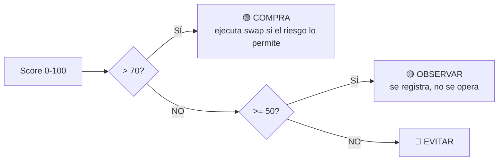

# Filtros del Bot (11 puntos)

## Sistema de Puntuación

Cada filtro asigna puntos según su peso. El score total determina la decisión:

- **COMPRA:** Score > 70
- **OBSERVAR:** Score 50-70
- **EVITAR:** Score < 50

### Escalera de decisión



El **score final** combina reglas e IA: `final = 70%·reglas + 30%·IA`. Si la IA
no responde, su peso cae a 0 y la decisión depende solo de las reglas.

### Distribución de pesos

```
Seguridad        ██████████████  25 pts   sin bundles · dev sin vender
Market cap       ██████████      20 pts   rango según modo
Global fees      ██████████      20 pts   ~ 0.15 SOL (sin fuente fiable hoy)
Edad del token   ████████        15 pts   < 24 h
Liquidez / MC    ██               5 pts   > 3 %
Top-10 holders   ██               5 pts   < 50 %
Volumen 5 min    ██               5 pts   > $2 K
Edad del creador ██               5 pts   > 3 días
Autoridades      ██               5 pts   mint/freeze deshabilitadas
Bundles          ██               5 pts   sin lanzamiento agrupado
Dev sell         ██               5 pts   el dev no ha soltado su bolsa
```

> ⚠️ Suma teórica máxima: **115 pts** (se normaliza a 100). La columna "Seguridad"
> concentra el 25/115 ≈ 22 % del peso: es el filtro más importante del sistema.

### Política de datos no verificados

Un dato on-chain que **no puede verificarse** (fallo de RPC, API sin datos, etc.)
se marca como `None` y el filtro otorga **0 pts**. Nunca se asume un valor
"de relleno" que infle el score.

Cada filtro reporta un `status`:
- `ok`: el filtro pasó con datos verificados.
- `fail`: el filtro falló con datos verificados (el token no cumple).
- `missing`: no había datos para evaluarlo (0 pts, conservador).

## Tabla de Filtros

> Los umbrales de la tabla corresponden al modo **equilibrado**
> (`src/config.py`). En `conservador`/`agresivo` cambian el rango de MC y la
> edad máxima — ver [Ajustes por Modo](#ajustes-por-modo).

| # | Filtro | Condición | Peso | Fuente de datos |
|---|--------|-----------|------|-----------------|
| 1 | Market Cap | $20K - $800K | 20 pts | DexScreener |
| 2 | Global Fees | > 0.15 SOL | 20 pts | Sin fuente fiable hoy → no verificado |
| 3 | Edad del token | < 1440 min | 15 pts | DexScreener |
| 4 | Seguridad | Sin bundles, dev no ha vendido | 25 pts | Análisis on-chain (Helius) |
| 5 | Liquidez/MC | > 3% | 5 pts | DexScreener |
| 6 | Top-10 Holders | < 50% del supply | 5 pts | Solana RPC |
| 7 | Volumen 5min | > $2K | 5 pts | DexScreener |
| 8 | Edad del creador | > 3 días | 5 pts | Solana RPC (wallet del dev) |
| 9 | Autoridades | Mint y Freeze deshabilitadas | 5 pts | Solana RPC |
| 10 | Bundles | No detectados | 5 pts | Análisis on-chain (Helius) |
| 11 | Dev Sell | Dev no ha vendido | 5 pts | Análisis on-chain (Helius) |

**Score máximo:** 115 pts (se normaliza a 100)

## Detalle de cada Filtro

### 1. Market Cap (20 pts)
- **Qué mide:** Capitalización de mercado del token
- **Rango óptimo:** $20K - $800K
- **Riesgo si falla:** Muy pequeño = scam; muy grande = poca ganancia
- **Caso de prueba:** ¿Qué pasa si MC = $19,999? → 0 pts

### 2. Global Fees (20 pts)
- **Qué mide:** Comisiones acumuladas en SOL
- **Umbral:** > 0.15 SOL
- **Interpretación:** Indica actividad real de trading
- **Estado:** Sin fuente fiable disponible por ahora → siempre `missing` (0 pts)
- **Caso de prueba:** ¿Qué pasa si fees = 0.149 SOL? → 0 pts

### 3. Edad del Token (15 pts)
- **Qué mide:** Tiempo desde el lanzamiento
- **Umbral:** < 1440 min (24h)
- **Riesgo si falla:** Tokens muy viejos ya no tienen momentum
- **Caso de prueba:** ¿Qué pasa si edad = 1441 min? → 0 pts

### 4. Seguridad (25 pts)
- **Qué mide:** Indicadores de seguridad on-chain
- **Criterios:** Sin bundles, dev no ha vendido
- **Peso:** El más alto del sistema
- **Detección:** Análisis de transacciones de la mint vía Helius (ver filtros 10 y 11)
- **Fallo de RPC:** `None` → 0 pts (no asumir seguridad)
- **Caso de prueba:** Si dev vendió aunque sea 1% → 0 pts

### 5. Liquidez/MC (5 pts)
- **Fórmula:** `liquidez / market_cap`
- **Umbral:** > 3%
- **Riesgo si falla:** Baja liquidez = slippage alto
- **Caso de prueba:** ¿Qué pasa si ratio = 2.99%? → 0 pts

### 6. Top-10 Holders (5 pts)
- **Qué mide:** Concentración del supply en top 10 wallets
- **Umbral:** < 50%
- **Riesgo si falla:** Pocas wallets pueden dump el precio
- **Caso de prueba:** ¿Qué pasa si top-10 = 50.1%? → 0 pts

### 7. Volumen 5min (5 pts)
- **Qué mide:** Volumen de trading en los últimos 5 minutos
- **Umbral:** > $2K
- **Interpretación:** Indica interés real
- **Caso de prueba:** ¿Qué pasa si volumen = $1,999? → 0 pts

### 8. Edad del Creador (5 pts)
- **Qué mide:** Tiempo de actividad de la wallet del dev
- **Umbral:** > 3 días
- **Wallet del dev:** Deriva del fee payer de la tx más antigua de la mint (pump.fun)
- **Riesgo si falla:** Wallets nuevas suelen ser scams
- **Caso de prueba:** ¿Qué pasa si edad = 2.9 días? → 0 pts

### 9. Autoridades (5 pts)
- **Qué mide:** Si Mint Authority y Freeze Authority están deshabilitadas
- **Umbral:** Ambas deshabilitadas
- **Riesgo si falla:** Dev puede minar tokens infinitos o congelar wallets
- **Caso de prueba:** Si Mint Authority activa → 0 pts

### 10. Bundles (5 pts)
- **Qué mide:** Si el lanzamiento se hizo en bundles (múltiples compras en la misma tx)
- **Umbral:** Sin bundles detectados
- **Detección:** Se escanean las ~10 transacciones recientes de la mint; si una sola
  firma incluye >1 wallet distinta comprando el token por primera vez → bundle.
  Resultado en caché por mint para no repetir llamadas RPC.
- **Riesgo si falla:** Bundles suelen ser snipers que dump inmediato
- **Caso de prueba:** Si se detecta 1 bundle → 0 pts

### 11. Dev Sell (5 pts)
- **Qué mide:** Si el dev ha vendido tokens después del lanzamiento
- **Umbral:** 0 ventas del dev
- **Detección:** Saldo del dev decreciente (pre/post balance) en las txs escaneadas
- **Riesgo si falla:** Dev vendiendo = señal de rug pull
- **Caso de prueba:** Si dev vendió 1 token → 0 pts

## Ajustes por Modo

Los umbrales cambian según el modo:

| Filtro | Conservador | Equilibrado | Agresivo |
|--------|-------------|-------------|----------|
| MC mínimo | $50K | $20K | $5K |
| MC máximo | $500K | $800K | $1M |
| Edad máxima | 720 min | 1440 min | 2880 min |
| Global Fees | 0.3 SOL | 0.15 SOL | 0.05 SOL |
| Compra base | 0.05 SOL | 0.03 SOL | 0.01 SOL |

## Casos de Prueba (QA)

| ID | Caso | Entrada | Resultado esperado |
|----|------|---------|-------------------|
| T-01 | Token perfecto | Todos los filtros OK | Score 100, COMPRA |
| T-02 | Token basura | Todos los filtros fallan | Score 0, EVITAR |
| T-03 | MC en límite | MC = $20,000 exacto | 20 pts |
| T-04 | MC un peso abajo | MC = $19,999 | 0 pts |
| T-05 | Token sin datos | API falla en todo | Score 0 (todos `missing`), EVITAR |
| T-06 | Múltiples fallos | MC OK, Fees falla, Edad OK | Score refleja fallo |

## Notas de Implementación

- Los datos no verificados se representan con `None` y puntúan **0 pts** (conservador).
  Nunca se inventa un valor que haga pasar el filtro.
- Cada detalle de filtro incluye `status: ok | fail | missing` para la UI.
- Los umbrales son inclusivos (>= y <=).
- El score se normaliza de 115 → 100 para consistencia.
- La detección de bundles/dev-sell se ejecuta una sola vez por token gracias a
  la caché en memoria y a la persistencia de tokens ya procesados (`seen_tokens`).
