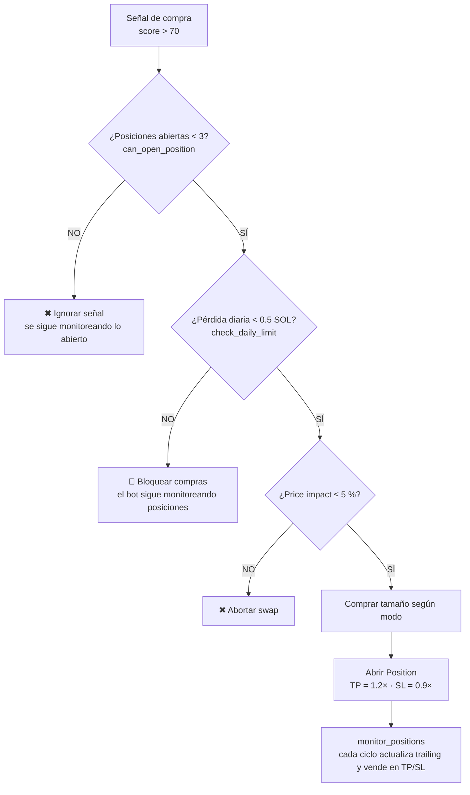

# Gestión de Riesgo

El riesgo se gestiona en dos capas:

1. **Al entrar** (`process_token`): límites máximos de posiciones y de pérdida
   diaria antes de comprar.
2. **Mientras se mantiene** (`monitor_positions`): TP, SL y trailing stop que
   se evalúan **al inicio de cada ciclo** (c/15 s), antes de buscar tokens nuevos.

## Parámetros principales

| Parámetro | Valor | Descripción |
|---|---|---|
| Take Profit (TP) | **+20 %** | Vende la posición completa al alcanzar la ganancia |
| Stop Loss (SL) | **−10 %** | Vende la posición completa al alcanzar la pérdida |
| Trailing stop | activa al **+5 %**, distancia **10 %** | Sube el SL conforme el precio hace máximos |
| Límite de pérdida diaria | **0.5 SOL** | Bloquea compras nuevas (no detiene el monitoreo) |
| Máximo posiciones abiertas | **3** | Ignora señales nuevas si hay 3 abiertas |
| Price impact | **máx 5 %** | Aborta la compra si el impacto excede el límite |
| Slippage | 1 % (100 bps) | Parámetro del quote de Jupiter |
| Modo por defecto | `DRY_RUN` | Simula swaps; no envía transacciones |

> Todos los swaps son **a mercado** vía Jupiter: no hay órdenes límite para
> memecoins. Las ventas cierran la posición completa (venta parcial en roadmap).

## Flujo de evaluación de riesgo

La venta en TP/SL también pasa por el límite de price impact: si un swap de
venta la excediera, se aborta y se reintenta en el siguiente ciclo.

## Take Profit (TP) y Stop Loss (SL)

- **TP (+20 %)**: el precio alcanza `entry × 1.20` → se vende la posición
  completa y se cierra como `closed`.
- **SL (−10 %)**: el precio cae a `entry × 0.90` → se vende la posición
  completa.
- **Prioridad**: si ambos niveles se cruzan en el mismo tick (gap), se evalúa
  primero el SL (la pérdida controlada manda).

Código: `risk.py` (`Position.entry_price`, `tp_price`, `sl_price`) y
`main.monitor_positions`.

## Trailing stop

- **Activación**: cuando el precio sube **+5 %** desde la entrada.
- **Distancia**: **10 %** por debajo del **precio máximo alcanzado**
  (`max_price_reached`), que se actualiza en cada monitoreo.
- Una vez activo, el SL ya no se mueve hacia abajo.

### Ejemplo numérico (entrada 100)

| Evento | Precio | SL/trailing | Resultado |
|---|---|---|---|
| Entrada | 100 | SL fijo 90 | — |
| Precio sube a 120 | +20 % | TP 120 alcanzado | **venta, TP** |
| Precio sube a 105 | +5 % | trailing activo: SL → 94.5 | — |
| Precio sube a 150 | máx. 150 | trailing: SL → 135 | — |
| Precio cae a 135 | −10 % del máx | trailing: SL 135 alcanzado | **venta con ganancia** |

## Límite de pérdida diaria

- **Umbral**: pérdida realizada acumulada ≥ **0.5 SOL** en el día.
- **Cálculo**: `storage.get_today_realized_loss` suma el P&L de las posiciones
  cerradas hoy (el día se recorta a partir de `datetime.max` para la marca `date`).
- **Efecto al alcanzarlo**: se bloquean **compras nuevas** (`check_daily_limit`),
  pero `monitor_positions` **sigue activo**: se sigue gestionando TP/SL/trailing
  de las posiciones ya abiertas y se pueden cerrar.
- **Reset**: el límite se recalcula solo; al cambiar la fecha vuelve a 0 (no hay
  un job aparte de reset).

## Máximo de posiciones

- **Límite**: 3 posiciones abiertas simultáneamente (`can_open_position`).
- **Acción**: se ignora la señal nueva; **no** se cierra ninguna posición para
  hacer hueco (no hay "cierre de la peor posición").
- **Caso de prueba**: 3 abiertas + nueva señal → se ignora la señal.

## Modos de operación

| Modo | Compra base | Máx. exposición | Perfil |
|---|---|---|---|
| Conservador | 0.05 SOL | 0.15 SOL (3 × 0.05) | Bajo riesgo, pocas operaciones |
| Equilibrado | 0.03 SOL | 0.09 SOL (3 × 0.03) | Balance riesgo/oportunidad |
| Agresivo | 0.01 SOL | 0.03 SOL (3 × 0.01) | Más operaciones, menor tamaño |

## Persistencia

Las posiciones viven en **SQLite** (`logs/bot.db`, tabla `positions`), no en
archivos JSON. Columnas relevantes: símbolo, dirección, modo, entry price,
TP/SL, `trailing_active`, `max_price_reached`, `status` (open/closed), P&L y
fechas. `storage.py` expone: `save_position`, `get_open_positions`,
`close_position`, `update_position_state`, `get_today_realized_loss`,
`get_closed_positions`.

## Resiliencia ante fallos de precios

- El precio de monitoreo viene de **DexScreener** (`fetch_by_address`). Si una
  consulta falla, se reintenta y, si no hay precio, **se salta el ciclo sin
  vender a ciegas**: la posición queda intacta y se reintenta en el próximo ciclo.
- Un swap real que falle (red, Jupiter) se reintenta en el siguiente ciclo; la
  posición no se marca como cerrada hasta que la venta termina.

## Casos de Prueba (QA)

| ID | Caso | Escenario | Resultado esperado |
|----|------|-----------|-------------------|
| R-01 | TP alcanzado | Precio +20 % | Vender, cerrar posición |
| R-02 | SL alcanzado | Precio −10 % | Vender, cerrar posición |
| R-03 | Trailing activo | +5 % y luego −10 % desde máx. | Vender con ganancia |
| R-04 | Límite diario | Pérdida acumulada 0.5 SOL | Bloquear compras (sigue monitoreando) |
| R-05 | Máximo posiciones | 3 abiertas + señal | Ignorar señal |
| R-06 | Modo equilibrado | Señal con score > 70 | Compra de 0.03 SOL |
| R-07 | Reset diario | Cambia la fecha | Pérdida diaria vuelve a 0 |
| R-08 | Precio API cae | `fetch_by_address` falla | No vender a ciegas; reintentar |
| R-09 | Price impact | impact > 5 % en venta | Abortar swap, reintentar ciclo siguiente |